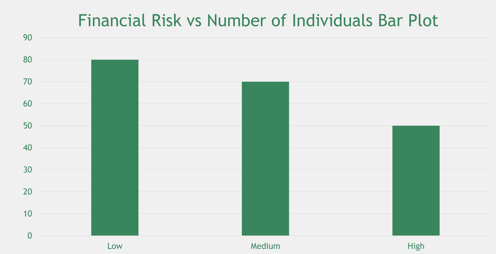
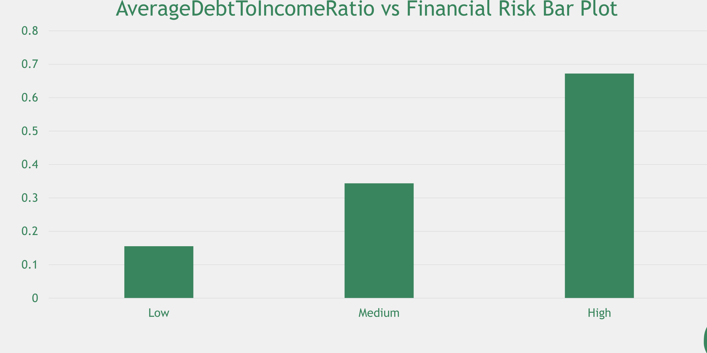
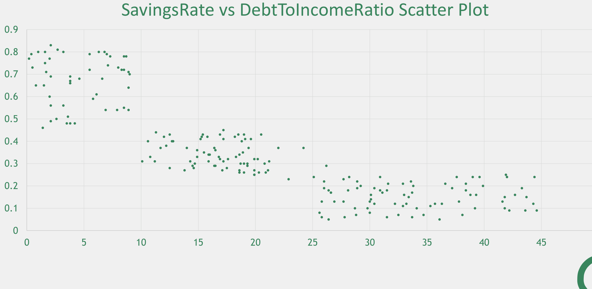
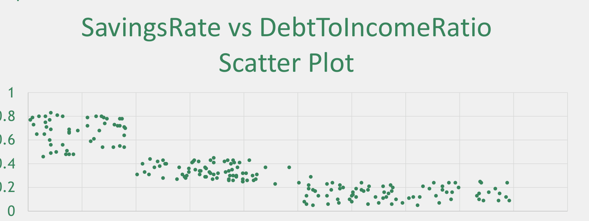
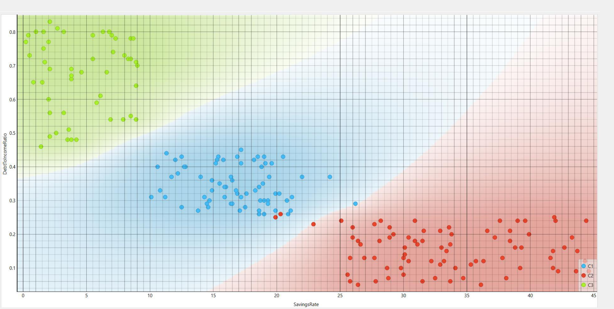
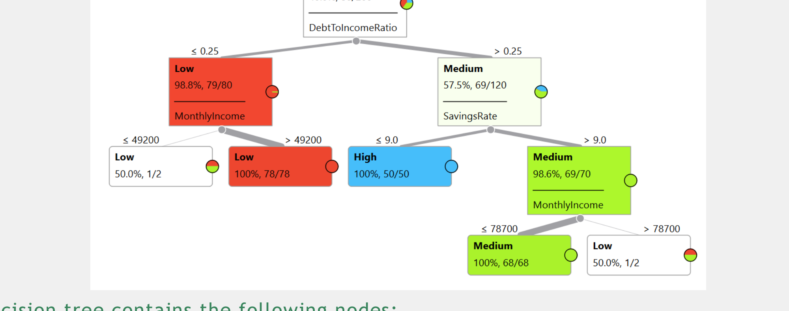
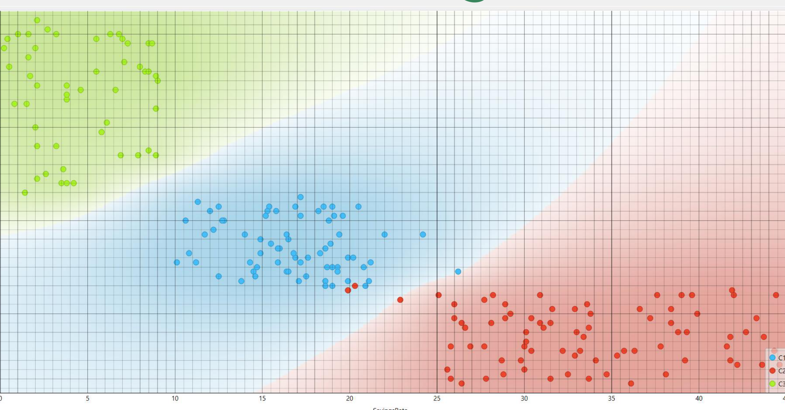
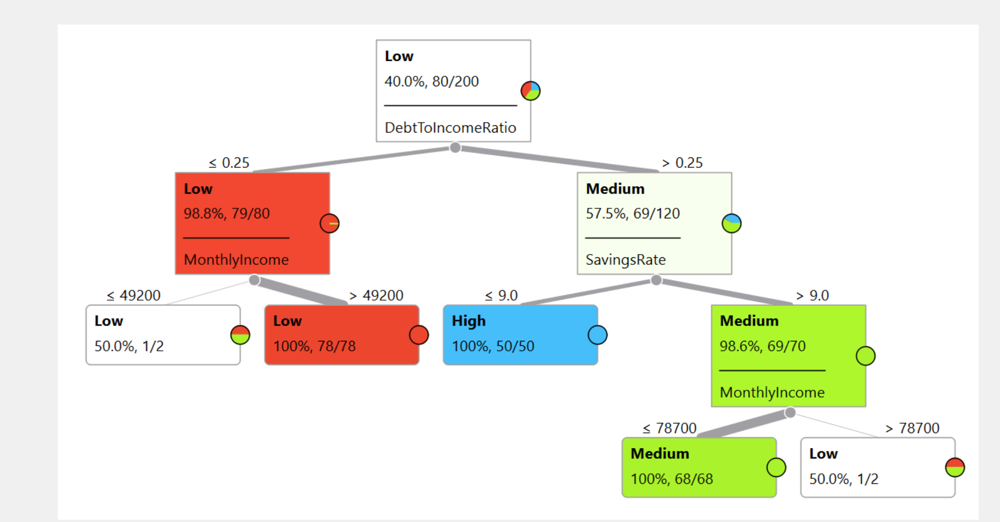
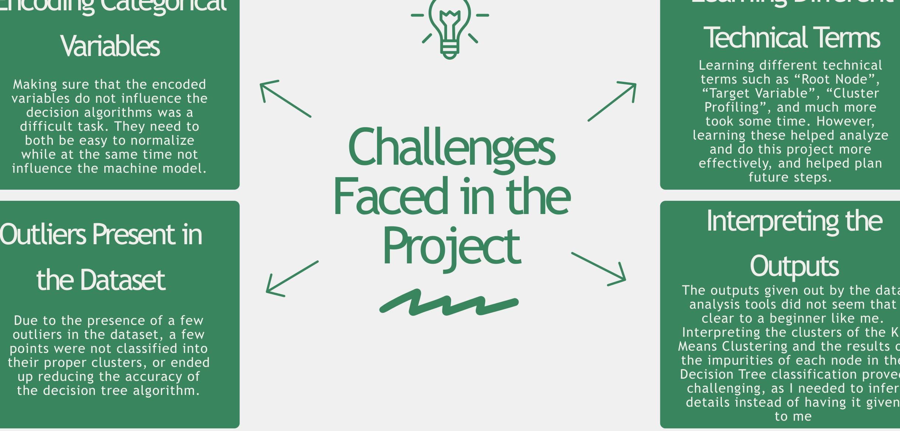
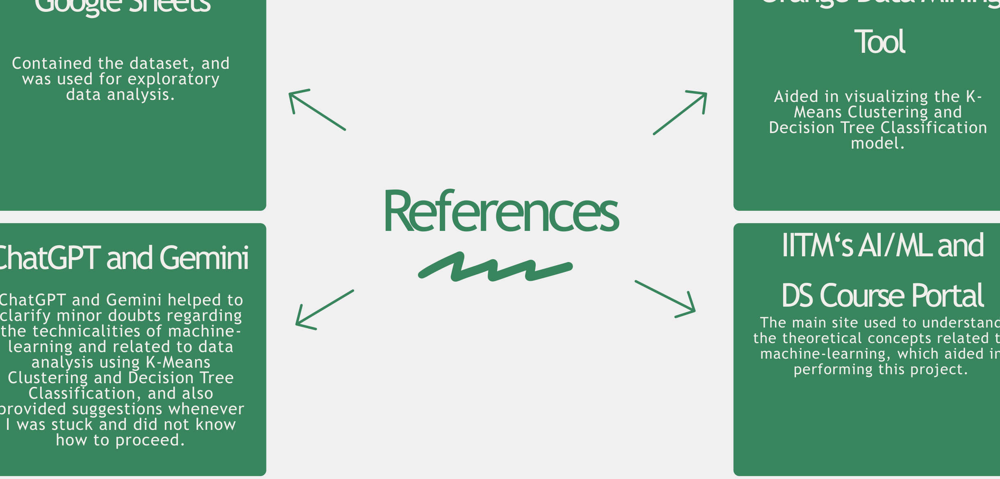

# Personal Finance Risk Assessment

## Acknowledgement

I would like to express my special thanks of gratitude to the teachers and staff of the Indian Institute of Technology, Madras (IITM) for giving me the opportunity to research and understand about the uses of machine learning in analyzing financial behaviours and habits, and also to learn and interpret different machine learning outputs.

I would also like to thank my school for providing me with access to this course, and my parents for enrolling me into this course, and being supportive throughout my journey in completing this project.

# Introduction

## Objective

• Analyze the given dataset, and understand how financial positioning and habits impacts the financial risk of an individual

• Learn how to implement machine learning techniques (unsupervised, supervised and sequential learning) to real world data

• Experience the systematic workflow of data science, from exploratory data analysis to pattern discovery, and also create a predictive model

## Dataset Overview

The given dataset has 9 features and 200 records of individuals, describing their financial habits and income status.

Key Features:

• MonthlyIncome: Contains the income an individual earn per month. Main factor which decides financial habits and has a major say in financial risk

• MonthlyExpenses: The expenditure of an individual per month. This, along with MonthlyIncome majorly influences financial habits and risk

• SavingsRate: Percentage of income that the individual saves per month. The higher the savings rate, the more financially disciplined the individual is

• DebtToIncomeRatio: Shows the ratio of total debt an individual has to their annual income. Also plays an important role in determining financial risk

• NumCreditCards: The number of active credit cards the individual has. Shows the credit exposure of the individual, and also information about borrowing or spending potential of the individual. This enables us to further analyze the monthly expenses of the user

• FinancialRisk (Target Variable): The final output, which represents the overall financial risk of the user. This is the main feature or target that the model will analyze to create its decision algorithm in supervised learning.

## Tools

- **Google Sheets**: Contained the dataset
- **Orange Data Mining and Excel**: For performing the machine learning techniques on the dataset
- **Canva and MS PowerPoint**: Template for the documentation
- **ChatGPT and Gemini**: For recommendations on how to proceed whenever there was a hurdle while performing the project and clarifying minor doubts

## Techniques

- **Exploratory Data Analysis (EDA)**: Analyzing the dataset
- **K-Means Clustering**: To get a visual understanding of how the data is present in all dimensions
- **Decision Trees**: To create a predictive model in order to analyze the financial risk of a new individual who is not present in the given dataset

# Exploratory Data Analysis

## Averages of Some Features

After performing some basic commands on the dataset using Google Sheets, the following data was found:

• Average MonthlyIncome: 58773 Currency Units

• Average MonthlyExpenses: 37901.5 Currency Units

• Average SavingsRate: 20.387%

## Financial Risk Distribution

## Analysis of Financial Risk Distribution

From the bar plot, it is clear that the given dataset is unbalanced, with the financial risk category “Low” predominating with 80 individuals classified as such. It is then followed by the category “Medium”, with 70 individuals classified under this, and finally “High”, with 50 individuals classified under this.

Thus, it is inferred that although there is a predominating category, it is not by much. There is quite a high number of individuals with high financial risk, as compared to those who have low financial risk.

## Debt vs Financial Risk

## Analysis of Debt vs Financial Risk Plot

The bar plot in the previous slide was the bar plot of the average DebtToIncomeRatio vs Financial Risk. From the plot, it is clear that those who had the highest financial risk also possessed the highest average debt-to-income ratio of around 0.6724 or 67.24%, and those with the lowest financial risk also had the lowest average debt-to-income ratio of around 0.1553 or 15.53%.

Here is the average debt to income ratio for each category of financial risk:

• Low: 0.1553 or 15.53%

• Medium: 0.3437 or 34.37%

• High: 0.6724 or 67.24%

From this, it is clear that the higher the debt-to-income ratio, the greater is the financial risk posed to the individual.

## SavingsRate vs DebtToIncomeRatio

## Analysis of Savings vs Debt Plot

In the previous slide, a scatter plot of debt-to-income ratio on y-axis is plotted against the savings rate on the x-axis of each of the 200 individuals. From the scatter plot, it is observed that there are approximately 3 “clusters” that are created, which each represents a particular group of individuals belonging to a particular financial risk zone.

The clusters are present in a decreasing “step-wise” shape. The first and highest cluster in the scatter plot represents the individuals in the “high” financial risk zone, as this group has the highest debt-to-income ratio and the least savings rate, and as seen from the previous bar graphs, these are the characteristics of an individual who has high financial risk.

The second cluster represents the “medium” financial risk category, due to the savings rate and debt-to income ratio both approximately around the half-way point.

The third and lowest “step” or “cluster” represents the individuals in the “low” financial risk zone, as they have a high savings rate and a low debt-to-income ratio. Also, this cluster has the greatest number of points among all the 3 clusters, further showing that most of the individuals in the given dataset have low financial risk.

# Methodology

## K-Means Clustering

### Definition

K-Means Clustering is an unsupervised method of machine learning which groups similar data points plotted on a scatter plot into “K” different “clusters” or groups.

This is done by calculating the Euclidean distance between points, and thus grouping a particular point with the label of the nearest “cluster”. The process of using K-Means Clustering is as follows.

### Encoding Categorical Variables

As K-Means Clustering works by calculating the Euclidean distance between 2 points, all its data points must be in the form of integers. Thus, each feature that does not contain integer or decimal values must be “encoded” into an integer or float point number. This especially helps if the variables are in the form of categories, as every variable that belongs to a particular category can get a particular value or number, and those that belong to a different category can get a different number. In this case, the “Gender” feature and “FinancialRisk” (target variable) must be encoded, in order to perform K-Means Clustering.

In order to simplify the encoding, the following encoding scheme will be followed:

The “Gender” Feature:

• Male = 0

• Female = 1

The “FinancialRisk” Feature:

• Low = 0

• Medium = 1

• High = 2

### Feature Normalization

As the dataset contains data points in different scales, the Euclidean distances between every point differs. Thus, those with low incomes may be categorized as a “low” financial risk individual due to the fact that this point is closer to those with high saving rates as the numbers are closer. Thus, it leads to error in the decision-making algorithm of the machine/model.

To avoid this error, the scale of all the units will be re-adjusted such that the points are properly placed in the scatter plot, thus giving more accurate results.

### Initialization of Cluster Centroids

Now begins the main part of K-Means Clustering. In this step, the “K” value, or the number of “clusters” or groups into which the data points must be classified into is selected. As the given dataset has 3 categories of the target variable FinancialRisk, that is, “Low”, “Medium”, and “High”, the value of K will be chosen as 3. Now, 3 points must be chosen as the centroids of the clusters, with respect to which the Euclidean distance of every other data point will be calculated. The points must be chosen in such a way that they can create the required clusters in as less steps as possible.

### Assignment Using Euclidean Distance

In this step, each point will be assigned to a particular cluster. The Euclidean distance of each point will be calculated with respect to each centroid, and whichever centroid is closest to the data point under analysis (whichever has the least Euclidean distance), the data point is assigned to that cluster. This step is done for each and every data point in the data set.

Euclidean Distance = [(x1 – c1)2 + (x2 – c2)2 + … + (xn – cn)2]0.5

Here, xi = Value/Coordinate of the ith feature of the data point

ci = Value/Coordinate of the ith feature of the centroid

n = Number of different features

Once every single data point is classified under a particular cluster, the coordinates of the centre of the cluster is calculated by calculating the mean coordinates of all the points in that cluster.

Mean Coordinate (of x-axis)= x1 + x2 + … + xn

n

Here, xi = x-coordinate of the ith point

n = total number of coordinates in the cluster

This formula is to be applied for every single feature/dimension, and then the final mean coordinate is determined.

### Assignment Using Euclidean Distance

Using the mean coordinates of the cluster, assignment of every single point to a new centroid and thus cluster is repeated. Due to this, a few data points which were initially part of a particular cluster may switch over to a different cluster, which is more accurate. This entire process can again be repeated any number of times, but most of the time after 2-3 repetitions, all points keep getting assigned to the same cluster. Thus, the K different clusters are formed

Due to the large number of data points in the given dataset, an external tool called as Orange Data Mining is used to perform the K-Means Clustering. It is displayed in the next slide.

### Cluster Interpretation

From the scatter plot in the previous slide, it is clear that there are 3 distinct clusters that are created – Green, Blue and Red. On further analysis, it is clear that:

Green = High Financial Risk, due to high debt-to-income ratio and low savings rate

Blue = Medium Financial Risk, due to medium debt-to-income ratio and medium savings rate

Red = Low Financial Risk, due to low debt-to-income ratio and high savings rate

The points are not plotted just on the basis of debt-to-income ratio and savings rate, but on all the features of the dataset. However, since it is impossible to see the points in n-dimensions of all the features, the 2 most determining features were chosen to view the scatter plot.

### Overall Flow

Encoding Categorical Variables    Feature Normalization    Initialization of Cluster Centroids         Assignment Using Euclidean Distance        Cluster Interpretation

# Decision Tree Classification

## Definition

Decision Tree Classification is a supervised learning method, in which the training model splits the given data repeatedly into many branches, so that it can classify the data efficiently, and thus come to a result.

## Feature Selection

Feature selection is the process by which the model or algorithm chooses the best “features”, such as Age, MonthlyIncome, DebtToIncomeRatio, etc., so that all the data points can be divided into their respective categories as efficiently as possible. This is basically a method of selecting features such that those data points which satisfy or do not satisfy a condition based on the feature chosen, can quickly be divided into their respective classes, and the Target Variable (FinancialRisk) can be easily achieved.

## Splitting Criteria

Now that the feature to compare each data point has been chosen, a threshold value or condition is needed in order to filter out the data points. This is usually done using mathematical conditions such as <, >, <=, >=, =, !=. The condition applied to split the data points into 2 or more groups based on the feature, is called the splitting criteria. The point in the decision tree algorithm where the splitting occurs is called a node.

Example:

SavingsRate  
>= 15  
FinancialRisk = Medium  
FinancialRisk = High  
True  
False

## Gini Impurity

### Impurity

Impurity in the context of decision tree classification, is a measure of how “unclean” or “impure” the data given to the decision tree algorithm is. In other words, it measures how mixed up or “messy” the data points are at a particular decision node (how many different classes they are divided into). If a node is high in impurity, it means that the probability of the data points being misclassified at that node is high. This is only theoretically. There are many ways of quantifying the impurity, and one such method is the Gini Impurity Index.

### Gini Impurity

Gini Impurity is a way of quantifying the impurity of the data and the node. It uses the fractions of data that is present at a particular node, to calculate how “messy” that node is, or in other words, the percentage of error that can occur at that node while taking a decision. It measures and quantifies how probable it is to misclassify a data point at the node. The formula for calculating the Gini impurity is:

GI = 1 - ∑ (pi)2

Where pi = probability of getting class i at the decision node

The lower the Gini impurity is, the purer the node is (the cleaner is the splitting of data points at the node)

## Node Splitting Process

In this step, the decision nodes are chosen such that they have the least impurity in their data points. If there is a presence of impurity, the nodes are split again into subsequent child nodes, in such a way that the impurity is reduced. This process happens till all the final “leaf” nodes are pure. As a result of this step, the impurity decreases after each split, and the final nodes are free from any impurity.

## Node Splitting Process

The following image is the decision tree classification of the given dataset.
The decision tree contains the following nodes:

• DebtToIncomeRatio: Root Node (Most important factor to reduce impurity as much as possible)

• MonthlyIncome: Important for classifying Low and Medium Risk individuals

• SavingsRate: Needed for classifying individuals as High Risk

## Interpretation of the Tree

From the decision tree, we can infer the following:

• The DebtToIncomeRatio feature is the most important factor in deciding whether an individual is to be classified as “Low”, “Medium”, or “High” financial risk. It splits 40% of all the data points into the 2 groups

• If the DebtToIncomeRatio is <= 0.25, the control goes to the left of the tree. Else, it goes to the right.

• The left part has a child node, where the MonthlyIncome of the data points which came to this side is compared.

• If the MonthlyIncome of the data points is greater than 49,200 currency units, the individual is classified as “Low” financial risk, and this node is a leaf node as it classifies the data completely. It is a pure node.

• If the MonthlyIncome of the data points is less than 49,200 currency units, the individual is again classified as “Low”. However, this node is not accurate, as it received very few data points, and is not used to make an effective analysis about the financial risk of an individual.

• The right part has 2 more child nodes. First comes the SavingsRate.

• If the SavingsRate is <= 9.0, the individual is classified as “High” financial risk. This is a leaf node, and has all the data points that come here classified as “High”.

• If the SavingsRate is > 9.0, another child node appears. This child node is based on the MonthlyIncome of the data points again.

• If the MonthlyIncome is <= 78,700, the individual is classified as “Medium” financial risk. This is also a leaf node, as it has all the data points coming here classified as “Medium”.

• However, if the MonthlyIncome is > 78,700, although the individual is classified as “Low” financial risk, due to the small amount of data points that came to this node, it is highly inaccurate. Therefore, this node is not used in deciding the financial risk of a data point.

# Results

## K - Means Clustering

### Number of Clusters

A total of 3 clusters were formed, which classified individuals as “Low”, “Medium”, and “High” financial risk.

### Characteristics of Each Cluster (Cluster Profiling)

The Red Cluster (Low Financial Risk):

• Have a high savings rate and monthly income, and low debt-to-income ratio and credit cards (around 2 credit cards per person)

• The individuals of this data set are financially stable and have cash reserves for future emergencies if any (inferred from high SavingsRate)

The Blue Cluster (Medium Financial Risk):

• Have an average savings rate, monthly income and expenditure, debt-to-income ratio and number of credit cards (around 3 to 4 credit cards per person)

• The individuals of this data set have normal conditions – neither too debt-heavy nor perfectly financially stable. They occupy the mid-ground.

The Green Cluster (High Financial Risk):

• Have low savings rate and monthly income, and high debt-to-income ratio and credit cards (about 6 per person)

• The individuals of this data set are at a huge financial risk, as they are debt-heavy and do not have enough cash reserves (which has been inferred from the low SavingsRate of such individuals).

## Decision Tree Classification

### Important Features

• DebtToIncomeRatio

• MonthlyIncome

• SavingsRate

### Logical Decision Path

• Root Node: DebtToIncomeRatio (Threshold value = 0.25)

• If DebtToIncomeRatio > 0.25 -> If SavingsRate < 9.0 -> High (Leaf Node)

• If DebtToIncomeRatio > 0.25 -> If SavingsRate >= 9.0 -> If MonthlyIncome <= 78,700 -> Medium

• If DebtToIncomeRatio <= 0.25 -> If MonthlyIncome > 49,200 -> Low

### Interpretation of Prediction Rules

• Root Node: DebtToIncomeRatio

• In the first step, the decision tree prioritizes separating the Low financial risk individuals from the Medium and High ones, by comparing their DebtToIncomeRatio.

• After this, it confirms whether the individual is Low-risk or not by checking MonthlyIncome, while simultaneously splitting the rest of the data points into High-risk and Medium-risk on the basis of their SavingsRate

• After this, it confirms if an individual is Medium-risk on the basis of MonthlyIncome again.

• Thus, it can be inferred that DebtToIncomeRatio, MonthlyIncome and SavingsRate are the defining factors of whether an individual is at financial risk or not.

# Insights and Learnings

## Financial Factors Affecting Financial Risk

• DebtToIncomeRatio: Most important feature. Effectively splits the data into 2 groups

• SavingsRate: Important for distinguishing between Medium and High-risk individuals

• MonthlyIncome: Important for confirming Low and Medium-risk individuals

## Patterns Revealed by K-Means Clustering

Through K-Means Clustering, the following patterns were revealed:

• Low-risk individuals usually have high savings rate and low debt-to-income ratios

• High-risk individuals usually have low savings rate and high debt-to-income ratios

• Without looking at the dataset, one can infer that 3 distinct clusters are formed from the given dataset

## Prediction Logic Explained by Decision Tree Classification

The Decision Tree explains very clearly how an individual is to be categorized into different financial risk categories. It systematically compares each feature value to the threshold at the decision node, and within 3 steps or questions, decides which financial risk category an individual belongs to. The decision algorithm is highly efficient, with very low scope for error. About 198 out of the 200 individuals in the dataset have correctly been classified using the decision tree. Thus, this algorithm shows that the logic behind assigning the Target Variable in the original dataset is very close to that created by the Decision Tree.

With the help of machine learning, one can now effectively classify any other external test data into the different financial risk categories. It helps provide a deep understanding of the dataset, and also helps predict the target variable of any future data points that may be added.

# Challenges and Recommendations

## Challenges Faced in the Project

### Encoding Categorical Variables

Making sure that the encoded variables do not influence the decision algorithms was a difficult task. They need to both be easy to normalize while at the same time not influence the machine model.

### Learning Different Technical Terms

Learning different technical terms such as “Root Node”, “Target Variable”, “Cluster Profiling”, and much more took some time. However, learning these helped analyze and do this project more effectively, and helped plan future steps.

### Outliers Present in the Dataset

Due to the presence of a few outliers in the dataset, a few points were not classified into their proper clusters, or ended up reducing the accuracy of the decision tree algorithm.

### Interpreting the Outputs

The outputs given out by the data analysis tools did not seem that clear to a beginner like me. Interpreting the clusters of the K-Means Clustering and the results of the impurities of each node in the Decision Tree classification proved challenging, as I needed to infer details instead of having it given to me

## Recommendations

### Improve Data Set Size

Increasing the data set size will help improve the accuracy of the prediction models.

### Introducing More Features

This will help provide additional details about the dataset, which can end up increasing the efficiency of decision-making even more

### Creating a Balanced Dataset

In the given dataset, Low-risk individuals were in majority. This may lead to bias due to majority in decision-making. Thus, with a balanced dataset, decision-making can focus more on the features than on the number of datapoints predominating a certain category of the target variable.

# Conclusion

The aim of this project was to effectively analyze the given dataset and create a predictive machine-learning model, which accurately predicts any future test data. This aim has been achieved. A model of about 99% accuracy has been created, which can effectively predict the financial risk that an individual is in.

Identifying the financial risk of an individual has more implications than just being a topic for building a predictive model:

• Personal finance analysis can be extended to households, which can help in family financial planning

• It helps create awareness among the public, and makes them learn the pros and cons of their financial habits

• The same financial analysis, when done on a massive scale, can aid the government in analyzing the economic condition of a particular area or even of the nation, which can provide insights on the subsequent steps that needs to be taken by the government.

With the help of machine learning, the above advantages can be further realized, as machine learning helps to identify financial risk categories instantly. Thus, lots of time can be saved. If the model is improved further, it can increase the accuracy of each decision even further, thus automating a very important yet overlooked part of our economy.

# References

## Google Sheets

Contained the dataset, and was used for exploratory data analysis.

## Orange Data Mining Tool

Aided in visualizing the K-Means Clustering and Decision Tree Classification model.

## ChatGPT and Gemini

ChatGPT and Gemini helped to clarify minor doubts regarding the technicalities of machine-learning and related to data analysis using K-Means Clustering and Decision Tree Classification, and also provided suggestions whenever I was stuck and did not know how to proceed.

## IITM‘s AI/ML and DS Course Portal

The main site used to understand the theoretical concepts related to machine-learning, which aided in performing this project.

